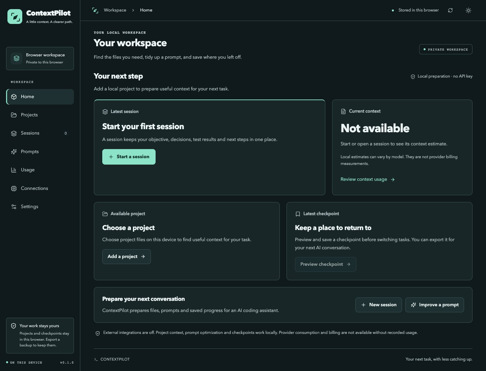

# ContextPilot (working name)

A local-first Rust CLI and dashboard for prompt optimization, repository context, usage analysis and recoverable managed sessions. Local features require no account or API key. Existing projects already use this name; it is provisional and not cleared for distribution. See [naming review](docs/naming-review.md).



## Features

- Original compass branding, light/dark themes and responsive dashboard navigation.
- Local project indexing, file-context review, selected exports and session linking.
- Conservative prompt optimization with original/suggested comparison and honest local estimates.
- Saved decisions, failures, verification evidence and recoverable checkpoints.
- Text/JSON continuation export for an external AI coding assistant.
- Optional consent-gated providers; all core preparation tools work without AI API keys.

## Browser workspace and full local app

The Cloudflare edition runs the genuine Rust prompt and checkpoint engine as WebAssembly on your device. No API key, account or server database is needed. Choose project files explicitly, search their contents locally, keep session notes, preview and save integrity-checked checkpoints, and export backups. Nothing selected is uploaded.

Projects, selected file contents, sessions and recovery snapshots are stored in this browser's IndexedDB. They are separate from the desktop app's SQLite workspace and other browsers or devices. Browser storage is not encrypted at rest; anyone using this browser profile can open it. Clearing site data removes it. Export a workspace backup regularly and protect that file like your source code. Importing a desktop checkpoint transfers only that explicitly selected file; it does not expose or sync the desktop workspace.

The native app still supports direct filesystem indexing and optional consent-gated AI providers. The browser edition has no provider connections, localhost requests, proxy, database binding or paid services. Cloudflare serves only public application assets, including the Rust WASM binary. Read the [deployment architecture](docs/deployment.md).

## Build and run

Requires stable Rust, a C compiler for bundled SQLite, and Node.js 22 or 24 with npm to build the dashboard. The native runtime verified here is macOS Apple Silicon. Intel macOS, Linux x86_64 and Windows x86_64 have also been cross-compiled and linked; their runtime and native-vault behavior remain untested. See [platform verification](docs/platform-verification.md).

```sh
cargo build --release --locked
cd apps/dashboard
npm ci
npm run build
cd ../..
./target/release/contextpilot doctor
./target/release/contextpilot init
./target/release/contextpilot dashboard
```

Open the announced loopback URL and paste the contents of the private `.contextpilot/dashboard-4317.token` file into Connect. Tokens are not printed to logs or placed in URLs. Stop with Ctrl+C. The Rust server serves the static export; no Node server is needed at runtime. When moving the binary, supply `dashboard --assets /absolute/path/to/apps/dashboard/out`. `cargo install --path crates/contextpilot-app --locked` installs the CLI locally.

## Frontend development and static hosting

```sh
cd apps/dashboard
npm ci
npm run dev             # development UI; full workflows need the Rust local API
npm run build           # full local UI in out/
npm run build:hosted    # private browser workspace in hosted-out/
```

For complete local workflows, use the Rust-served production dashboard as described above. The Next.js development server alone does not proxy the Rust API; same-origin authorization is intentionally enforced. Hosted builds use a separate export directory, preserving the local `out/` build. No public backend URL or secret hosting environment variables are required.

Cloudflare Pages settings: root `apps/dashboard`, **Next.js (Static HTML Export)**, build `npm run build:hosted`, output `hosted-out`, Node 24. Direct Upload can deploy the reviewed static directory without granting access to other GitHub repositories. Use an assigned free `*.pages.dev` address, not a purchased domain. See [deployment instructions](docs/deployment.md) for exact procedures, limitations and Vercel compatibility settings.

## Local workflow

```sh
contextpilot tokens fixtures/task.md
contextpilot tokens task.md --provider openai --model gpt-4o
contextpilot optimize task.md --output optimized-task.md
contextpilot project add . --name 'My project'
contextpilot project index --root .
contextpilot retrieve 'login error' --root . --max-files 6
contextpilot session create 'Fix login' --requirement 'Test auth' --constraint 'Never deploy' --limit 32000
contextpilot project link SESSION_ID PROJECT_ID
contextpilot session retrieve SESSION_ID 'login error'
contextpilot context status --session SESSION_ID
contextpilot compact --session SESSION_ID --preview
contextpilot compact --session SESSION_ID --commit --revision PREVIEW_REVISION
contextpilot checkpoint restore CHECKPOINT_ID --yes
contextpilot handoff --session SESSION_ID NEW_DIRECTORY
contextpilot tool-output build.log --exit-status 1 --output complete-output.txt
```

File exports refuse existing destinations. Counts distinguish exact supported text-encoding counts, heuristic estimates and provider-reported usage. `tokens DIRECTORY` totals all eligible complete UTF-8 files (at most 512 KiB each), reports files analyzed and explicit coverage, and fails instead of returning a partial total if repository scan limits are exceeded. Directory tokenization, retrieval and indexing apply effective project overrides when the selected canonical root exactly matches a registered project, otherwise global settings. Exact text counts exclude message framing, tools, images and provider-internal tokens. Unknown models fall back explicitly rather than guessing. Smaller prompts do not establish lower end-to-end cost or better quality.

Repository selection respects Git ignore rules, `.contextpilotignore`, configured exclusions and secret/generated-source filters. Metadata caches validate current hashes. Symbols/imports inform deterministic ranking. Parsable Rust selects the complete containing function; other languages or unparseable Rust return complete files with an explicit fallback note. CLI/project excerpt budgets visibly mark omissions. Retrieval scans are capped at 20,000 files / 128 MiB. Reattaching identical source reuses it; changed/deleted source is removed with recovery snapshots.

Compaction preserves requirements, failures, decisions and verification evidence while reducing safe repetition and recognized routine compiler progress. `tool-output` applies the configured output target conservatively: all other redacted lines and exit status survive even when the result exceeds that target. The complete redacted tool output can be saved privately. No command is executed by that feature.

## Settings, evidence and reports

```sh
contextpilot config --file settings.json
contextpilot project config PROJECT_ID --file project-overrides.json
contextpilot models --file model-metadata.json
contextpilot price pricing.json
contextpilot import-usage normalized-usage.json
contextpilot evaluate evaluation-evidence.json
contextpilot report --output report.json
contextpilot instructions --output AGENT-INSTRUCTIONS.md
contextpilot schema
contextpilot backup backup.sqlite
contextpilot restore-backup backup.sqlite NEW_DIRECTORY
```

Global/project settings cover budgets, overhead, text tokenizer, exclusions, storage/privacy and efficiency profiles. File counts, CLI/project excerpt-token budgets and inline report limits are enforced. Tool-output targets drive conservative owned-output processing; protected content can exceed the target. Verbosity/subagent/verification preferences become exported guidance, not control over external agents. Global storage/external disables cannot be bypassed by project overrides.

Usage imports require provenance and stable identity and reject conflicting duplicates. Analytics group usage by project/session/provider/model/day, keep cache/reasoning subsets separate, separate optimization overhead and show unknown pricing explicitly. Quality/retry comparisons require supplied controlled baseline/optimized evidence; they are not self-generated experiments or causal proof.

## Optional providers

Set `OPENAI_API_KEY` or `ANTHROPIC_API_KEY` in the backend environment, or store a key from a secret manager through `providers credentials PROVIDER --stdin`. Interactive terminal input is refused to avoid echoed secrets. Keys are never command arguments or dashboard fields. Native vault storage has no plaintext fallback; environment values take precedence.

Enable `external_enabled:true` through configuration, then explicitly opt in:

```sh
contextpilot session run SESSION_ID --provider openai --model YOUR_MODEL --allow-external
contextpilot optimize task.md --mode deep --provider openai --model YOUR_MODEL --allow-external
contextpilot providers count anthropic --model YOUR_MODEL --file task.md --allow-external
```

Generation/deep/count send selected redacted content externally. Anthropic supports remote counting; OpenAI counting is explicitly unsupported. Deep candidates must pass independent conservative local validation. Provider discovery reports environment presence and an unqueried vault, not a successful connection. No live paid provider request has been verified. An isolated nonsecret macOS Apple Silicon vault roundtrip passed and confirmed deletion; existing provider credentials were never read. Linux/Windows and Intel macOS native-vault runtime checks remain pending. See [provider integrations](docs/provider-integrations.md).

## Data and privacy

Default storage is `.contextpilot/state.sqlite`; override with global `--data-dir` or `CONTEXTPILOT_DATA_DIR`. Managed sessions intentionally retain redacted context/recovery snapshots. Prompt-body logging defaults off; enabling `prompt_logging` explicitly stores redacted optimizer inputs/outputs. Event retention defaults to 30 days; sessions/checkpoints persist until explicit deletion. Set `managed_session_storage:false` to disable new managed writes. Backups/exports can contain private context, and SQLite is not encrypted at rest. No telemetry.

The API binds loopback, validates Host/Origin and requires bearer authentication. Private files use owner-only Unix permissions or protected Windows ACLs. No external assistant private sessions are accessed or modified. Manual handoff files provide the integration boundary. See [privacy](docs/privacy.md) and [security](SECURITY.md).

## Verification and development

```sh
cargo test --workspace --locked
cargo fmt --all --check
cargo clippy --workspace --all-targets -- -D warnings
cargo build --release --locked
cd apps/dashboard
npm run typecheck
npm run lint
npm run build
npm audit
npm test
npm run build:hosted
npm run test:hosted
python3 ../../scripts/security-check.py --staged
```

`python3 scripts/acceptance.py target/debug/contextpilot` exercises local persistence and backup recovery. `python3 scripts/demo.py target/debug/contextpilot` creates an isolated, clearly fictional demo without fabricated provider usage. JSON Schemas derive from Rust types; they are not a full OpenAPI specification. Deterministic HTTP mocks verify adapters without keys. Current evidence and external runtime/release prerequisites are recorded in [verification](docs/verification.md) and [implementation](docs/implementation.md).

MIT license. The private source repository and any static hosting release contain no personal workspace records. No paid plan or service is required for the full local application. Further documentation: [CLI](docs/cli-reference.md), [API](docs/api.md), [architecture](docs/architecture.md), [compaction/recovery](docs/context-compaction.md), and [troubleshooting](docs/troubleshooting.md).

## Repository publication and PHP 0 operation

Real provider credentials belong only in the local backend environment; `.env.example` contains comments, and the app does not automatically load it. Never put AI keys in `NEXT_PUBLIC_*` variables. The sole hosted build flag is the non-secret `NEXT_PUBLIC_CONTEXTPILOT_MODE=hosted`.

Personal screenshots/reports, `.contextpilot`, databases, bearer codes, private environment files, exports, logs, caches and build artifacts are ignored. Synthetic test fixtures remain in source. Keep private data backups outside the Git staging set. The source scanner prints locations rather than secret values.

GitHub Actions checks are manual (`workflow_dispatch`) so pushing this private repository does not automatically consume hosted-runner quota. Run the full checks locally at PHP 0; starting a hosted workflow may consume your account's included minutes. No paid runner, hosted database, analytics, telemetry or provider API is enabled. Cloudflare Pages static hosting uses a limited free tier; current limits and eligibility must be rechecked for later releases.
